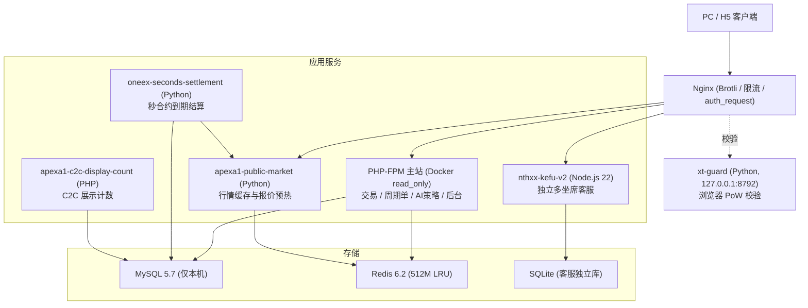

# OneEx / Apexa1 交易平台

> 更新日期：2026-11-23 · [返回主页](https://github.com/leee991)

这套系统是数字资产交易相关的线上项目，由早期的 PHP（ThinkPHP / FastAdmin）主站演进过来。后面业务流量和攻击变多之后，陆陆续续把行情缓存、秒合约结算、防刷网关和在线客服都拆出来独立跑了。

这里放的是整理后的架构图、接口说明、脱敏示例配置和各模块的函数签名骨架。

## 整体结构

## 重点做过哪些改造

1. **换掉了 2 秒一次的 `docker exec` 刷行情**
   - 原来定时任务每 2 秒进容器执行一次脚本拉行情，CPU 和容器开销很高。后来拆成 `apexa1-public-market` 和常驻预热服务，把 45 个交易对的公共报价缓存在内存和 Redis 里，主站直接读缓存，负载降得很明显。
2. **用 Nginx + Python 自己写了个防刷门禁（`xt-guard`）**
   - 线上老被脚本扫描和 CC 刷接口，不想接第三方验证码拖慢首屏，就利用 Nginx 的 `auth_request` 写了个监听本机 `8792` 的校验服务。
   - 浏览器端在 WebWorker 里跑纯 JS 的 SHA-256（兼容没开 `crypto.subtle` 的环境）算 14 位前导零，过了以后发个绑定 `IP + UA + Host` 的 HttpOnly Cookie，有效期 30 分钟，活跃页面最多续期 8 小时。
3. **把秒合约结算从 PHP 请求里拆出来**
   - `oneex-seconds-settlement` 单独跑守护进程，直接拿最新报价结到期单，不阻塞正常的 PHP-FPM 进程。
4. **容器和数据库收口**
   - PHP-FPM 容器改成了 `read_only: true` + `no-new-privileges:true`，`/tmp` 和 `/run` 挂带 `noexec` 的 tmpfs；MySQL 和 Redis 全部只绑 `127.0.0.1`。
5. **独立客服（`nthxx-kefu-v2`）**
   - 用 Node.js 22 + SQLite 单独跑，支持坐席分配、撤回、已读、TOTP 谷歌验证和 WebPush 桌面提醒，不跟主库混在一起。

## 目录说明

- `docs/ARCHITECTURE.md`：各服务边界、`xt-guard` 校验流程和数据库/Nginx 参数记录
- `docs/API_CONTRACT.md`：主要接口路径和说明
- `config/`：整理后的 Docker Compose、Nginx、PHP 配置模板和 `.env.example`
- `skeleton/`：PHP 控制器、Python 行情/结算/防护和 Node 客服的模块结构与函数签名
- `DIRECTORY_TREE.txt`：代码目录树统计
