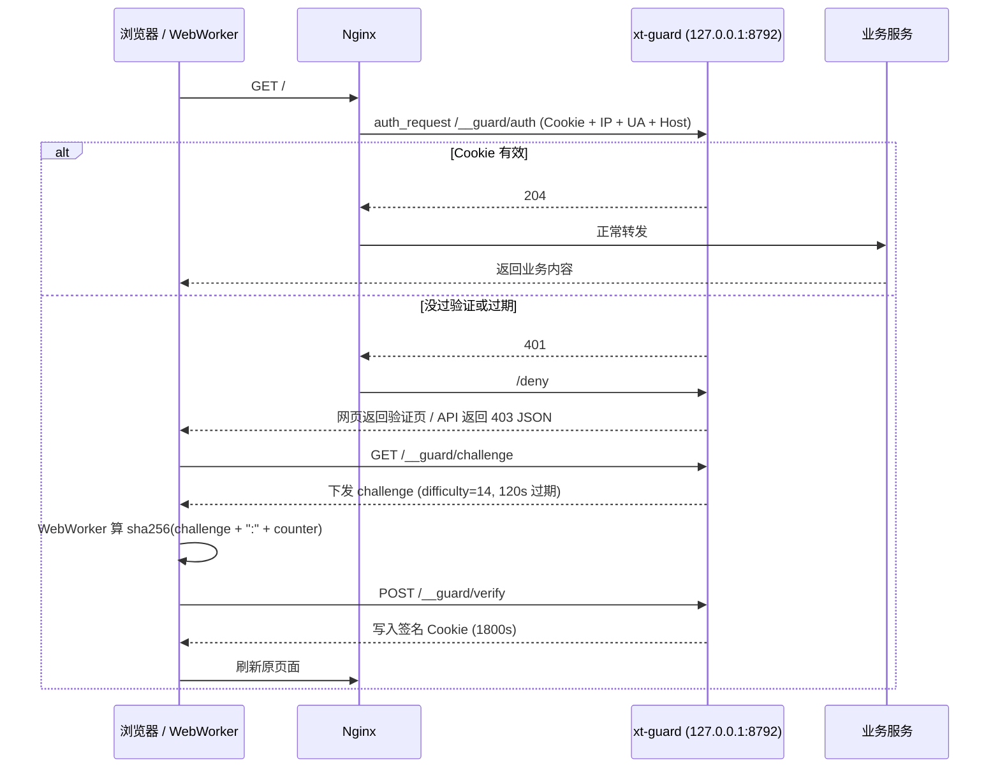

# 架构与改造记录 — OneEx / Apexa1

## 1. 服务拆分清单

| 模块 | 语言 | 跑在哪 | 存储 | 干嘛的 |
|---|---|---|---|---|
| `apexa-backend` | PHP 7.3 (ThinkPHP / FastAdmin) | Docker (`read_only`) | MySQL 5.7 + Redis 6.2 | 主站业务、周期单、AI 策略、财务审核和管理后台 |
| `apexa1-public-market` | Python 3 | Systemd | 内存 + Redis | 45 个币对的只读公共行情缓存 |
| `apexa1-market-data` | Python 3 | Systemd | Redis / MySQL | 常驻报价预热，替代原来的 2 秒定时脚本 |
| `oneex-seconds-settlement` | Python 3 | Systemd | MySQL + 行情 | 到期秒合约单结算 |
| `apexa1-c2c-display-count` | PHP CLI | 定时任务 | MySQL | 维护 C2C 挂单展示数量 |
| `xt-guard` | Python 3 + JS Worker | Systemd (`127.0.0.1:8792`) | 内存缓存 | 浏览器 PoW 防刷校验 + Nginx `auth_request` |
| `nthxx-kefu-v2` | Node.js 22 | Docker / Systemd | 独立 SQLite | 在线客服，与交易数据完全分开 |

## 2. `xt-guard` 校验流程

## 3. 线上参数调优备忘
- **MySQL**：`innodb_buffer_pool_size=1G`、`max_connections=150`、`tmp_table_size=64M`、`thread_cache_size=32`，只听 `127.0.0.1`。
- **Redis**：限 512MB，`allkeys-lru` 淘汰策略，开 AOF 持久化，只听 `127.0.0.1`。
- **Nginx**：静态文件开 Brotli + Gzip，全局限流 `15r/s burst=100`，API 限流 `8r/s burst=30`，challenge 签发 `10r/m burst=10`，避免误伤正常用户轮询。
